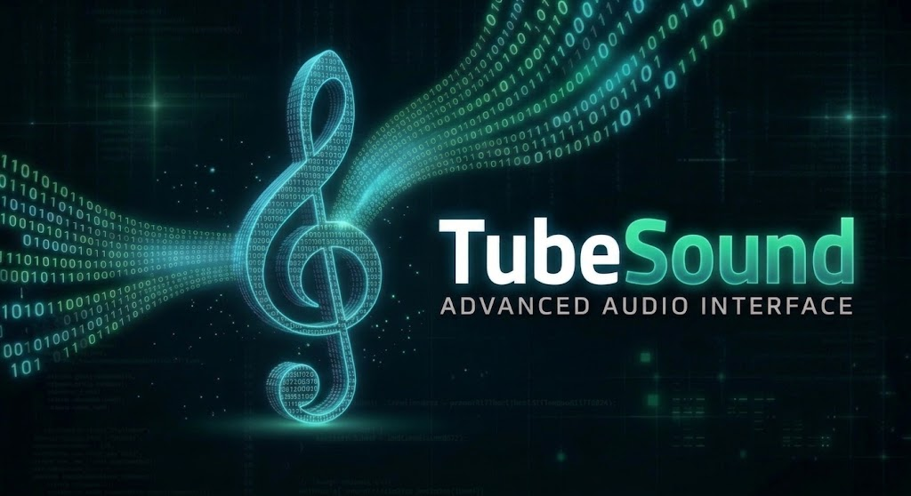

# TubeSounds



Portabler Audio-Downloader im Matrix-Look. Link einfügen, Format wählen, fertig: TubeSounds speichert die Tonspur eines Videos als **MP3**, **M4A** oder **WAV**. Eine einzige Programmdatei pro Plattform, keine Installation, ffmpeg ist schon eingebaut. Läuft z. B. direkt vom USB-Stick unter Windows, macOS und Linux.

> **Bitte beachten:** Nicht jeder Audiostream darf heruntergeladen werden. TubeSounds ist nur für Inhalte gedacht, für die du die nötigen Rechte hast. Siehe [Rechtlicher Hinweis](#rechtlicher-hinweis).

## So funktioniert es

- TubeSounds öffnet ein Fenster mit Linkfeld, Formatwahl und Download-Knopf.
- Die beste verfügbare Tonspur wird mit [yt-dlp](https://github.com/yt-dlp/yt-dlp) geladen und mit dem eingebauten ffmpeg ins gewählte Format umgewandelt.
- Die fertige Datei landet standardmäßig im Ordner **Downloads**, der Zielordner ist in den Einstellungen frei wählbar.
- TubeSounds merkt sich Einstellungen und Formatwahl in `tubesounds.json` **direkt neben dem Programm**. Programm und Einstellungen zusammen auf den Stick kopieren, fertig. Ist der Ordner schreibgeschützt, landet die Datei als `.tubesounds.json` im Benutzerordner.

## Funktionen

- Formate **MP3**, **M4A** (AAC) und **WAV**
- Einstellbare **Bitrate** (128, 192, 256 oder 320 kbit/s), **Abtastrate** (Original, 44,1 kHz, 48 kHz) und **Kanäle** (Stereo oder Mono)
- Titel, Kanal und Datum werden auf Wunsch in die Datei geschrieben
- Frei wählbarer **Zielordner**
- Fortschrittsbalken und Statuszeile, der Download läuft im Hintergrund
- Link einfügen mit `Strg+V` oder Rechtsklick, Download starten mit `Enter`
- Oberfläche im Matrix-Look mit fallenden Zeichen, abgestimmt auf die Farben des Banners
- Auch per Kommandozeile nutzbar

## Einstellungen

Oben rechts im Fenster auf **[ EINSTELLUNGEN ]** klicken:

| Einstellung | Bedeutung |
| --- | --- |
| Zielordner | Wohin die Dateien gespeichert werden. „Standard“ = Downloads-Ordner |
| Bitrate (MP3/M4A) | Qualität bzw. Dateigröße. 192 kbit/s ist ein guter Standard, 320 kbit/s die höchste Stufe. WAV ist immer unkomprimiert |
| Abtastrate | „Original“ übernimmt die Abtastrate der Quelle, sonst wird auf 44,1 kHz (CD) oder 48 kHz umgerechnet |
| Kanäle | Stereo oder Mono |
| Metadaten | Titel, Kanal und Datum in die Datei schreiben |

Über **[ RECHTLICHES ]** lässt sich der rechtliche Hinweis jederzeit erneut anzeigen.

## Starten

1. Passende Datei aus den [Releases](../../releases) laden.
2. Auf den USB-Stick oder an einen beliebigen Ort kopieren und starten.
3. Beim ersten Start den [rechtlichen Hinweis](#rechtlicher-hinweis) lesen und bestätigen.

| System | Datei |
| --- | --- |
| Windows | `TubeSounds-windows.exe` |
| macOS (Apple Silicon) | `TubeSounds-macos.zip` (enthält `TubeSounds.app`) |
| Linux | `TubeSounds-linux` |

Hinweise zu den Betriebssystemen:

- **Windows:** SmartScreen warnt bei unbekannten Programmen. „Weitere Informationen“ → „Trotzdem ausführen“.
- **macOS:** Die App ist nicht signiert. Zip entpacken, dann einmalig `xattr -dr com.apple.quarantine TubeSounds.app` im Terminal ausführen oder per Rechtsklick → „Öffnen“ starten.
- **Linux:** `chmod +x TubeSounds-linux && ./TubeSounds-linux`

Die Windows-Version trägt das TubeSounds-Icon. Für Verknüpfungen unter macOS und Linux liegt [`assets/icon.png`](assets/icon.png) bzw. [`assets/tubesounds.ico`](assets/tubesounds.ico) bereit.

### Kommandozeile

Mit einem Link als Argument arbeitet TubeSounds ohne Fenster und nutzt die gespeicherten Einstellungen:

```
TubeSounds-linux "https://www.youtube.com/watch?v=..." -f mp3
```

```
-f mp3|m4a|wav   Format (Standard: wie zuletzt gewählt)
-o <ordner>      Zielordner (Standard: wie in den Einstellungen)
```

Unter Windows hat die Programmdatei kein Konsolenfenster, dort die Kommandozeile über `python -m tubesounds` aus dem Quelltext nutzen.

## Wenn Downloads nicht mehr klappen

YouTube ändert immer wieder etwas an seiner Seite. Dann braucht yt-dlp ein Update. Ein neuer Release-Tag (siehe [Selbst bauen](#selbst-bauen)) baut TubeSounds automatisch mit der aktuellen yt-dlp-Version.

## Rechtlicher Hinweis

TubeSounds ist ausschließlich für Inhalte gedacht, für die du die nötigen Rechte hast: eigene Videos, gemeinfreie oder frei lizenzierte Inhalte oder Inhalte, deren Rechteinhaber das Herunterladen erlaubt. Musik und andere Werke sind in der Regel urheberrechtlich geschützt, und die Nutzungsbedingungen von YouTube erlauben Downloads grundsätzlich nur mit Zustimmung.

Für die Auswahl und Nutzung der Inhalte bist allein du verantwortlich. TubeSounds wird ohne jede Gewährleistung bereitgestellt, eine Haftung der Entwickler ist ausgeschlossen, soweit gesetzlich zulässig. TubeSounds steht in keiner Verbindung zu YouTube oder Google.

Den vollständigen Text findest du in [DISCLAIMER.md](DISCLAIMER.md). TubeSounds zeigt ihn beim ersten Start an und startet erst nach Bestätigung.

## Selbst bauen

Benötigt Python 3.10 oder neuer (unter Linux zusätzlich `python3-tk`).

```
pip install -r requirements.txt pytest
python -m pytest           # Tests
python -m tubesounds       # Oberfläche aus dem Quelltext starten
```

Portable Datei für das aktuelle System bauen:

```
pip install pyinstaller
pyinstaller --onefile --windowed --name TubeSounds --icon assets/tubesounds.ico \
  --collect-all imageio_ffmpeg --collect-data tubesounds tubesounds_app.py
```

Ein Git-Tag `v*` baut über GitHub Actions automatisch ein Release für Windows, macOS und Linux:

```
git tag v0.2.0 && git push origin v0.2.0
```

## Lizenz

TubeSounds ist freie Software: Copyright © 2026 afamaus.

Du kannst das Programm unter den Bedingungen der **GNU General Public License Version 3** (oder, nach deiner Wahl, jeder späteren Version), wie von der Free Software Foundation veröffentlicht, weitergeben und verändern. Wer eine veränderte Fassung weitergibt, muss sie ebenfalls unter der GPL samt Quelltext weitergeben. TubeSounds wird ohne jede Gewährleistung bereitgestellt. Der vollständige Text steht in [LICENSE](LICENSE).

**Name und Logo** ("TubeSounds", Banner, Logo und Icons) sind von der GPL ausgenommen und bleiben bei afamaus. Abgewandelte Fassungen (Forks) bitte unter eigenem Namen und Logo veröffentlichen.

Fremdkomponenten und ihre Lizenzen stehen in [NOTICE](NOTICE).

## Mitmachen

Fehlermeldungen und Vorschläge gern als [Issue](https://github.com/afamaus/tubesound/issues), Änderungen als Pull Request. Mit einem Pull Request stellst du deinen Beitrag unter dieselbe Lizenz (GPLv3 oder später).
